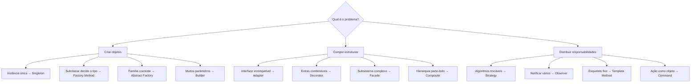

# Catálogo GoF — Unidade 2 · Aula 3

Catálogo visual e executável dos 12 padrões GoF criacionais, estruturais e comportamentais, em **PT-BR**, com Java 21, Spring Boot 3, Maven e JUnit 5.

> **Fonte:** Unidade 2 · Aula 3 — Prof. Nataniel Paiva. Os cenários e nomes de classes de exemplo são didáticos e estão marcados como *exemplo adicional* quando extrapolam a descrição conceitual dos slides.

## Conteúdo

| Categoria | Padrões |
|---|---|
| [Criacionais](catalogo/criacionais/) | [Singleton](catalogo/criacionais/singleton.md) · [Factory Method](catalogo/criacionais/factory-method.md) · [Abstract Factory](catalogo/criacionais/abstract-factory.md) · [Builder](catalogo/criacionais/builder.md) |
| [Estruturais](catalogo/estruturais/) | [Adapter](catalogo/estruturais/adapter.md) · [Decorator](catalogo/estruturais/decorator.md) · [Facade](catalogo/estruturais/facade.md) · [Composite](catalogo/estruturais/composite.md) |
| [Comportamentais](catalogo/comportamentais/) | [Strategy](catalogo/comportamentais/strategy.md) · [Observer](catalogo/comportamentais/observer.md) · [Template Method](catalogo/comportamentais/template-method.md) · [Command](catalogo/comportamentais/command.md) |

Cada ficha apresenta intenção, problema, diagrama Mermaid, participantes, exemplo Java, consequências, relação com SOLID e o smell que pode indicar o padrão. Os diagramas Mermaid editáveis estão em [`diagramas/`](diagramas/).

## Qual padrão escolher?



## Executar

Requer JDK 21 e Maven 3.x.

```bash
mvn test
```

Os exemplos são classes de domínio Java puro para tornar cada padrão visível; o módulo `spring` apresenta integrações adicionais quando apropriado. Nenhum exemplo usa Lombok.

## Spring: equivalentes e exemplos adicionais

| Padrão | Aplicação com Spring |
|---|---|
| Singleton | Beans têm escopo `singleton` por padrão; prefira injeção de dependência a `getInstance()`. |
| Factory Method / Abstract Factory | Métodos `@Bean` em `@Configuration`; seleção de implementação por perfil ou `@ConditionalOnProperty`. |
| Builder | Builder manual para fins didáticos; sem Lombok nos exemplos. |
| Adapter | `@Component` implementando a interface da aplicação em torno de uma biblioteca externa. |
| Decorator | Composição de beans, com seleção explícita ou `@Primary`. |
| Facade | Um `@Service` pode coordenar subsistemas, por exemplo `PedidoFacade.finalizarPedido()`. |
| Composite | Árvore de objetos de domínio em Java puro. |
| Strategy | Injeção de `Map<String, EstrategiaFrete>` ou `List<EstrategiaFrete>`. |
| Observer | `ApplicationEventPublisher` e consumidores `@EventListener`; base útil para arquitetura orientada a eventos. |
| Template Method | Classe abstrata com subclasses registradas como `@Component`. |
| Command | Interface com `executar()`/`desfazer()` e histórico em memória. |

O exemplo Spring de publicação de evento está em `src/main/java/br/edu/arquitetura/u2a3/spring/observer`.

## Comparativos

Veja [Factory Method × Abstract Factory, Adapter × Facade e Strategy × Template Method](comparativos.md).
