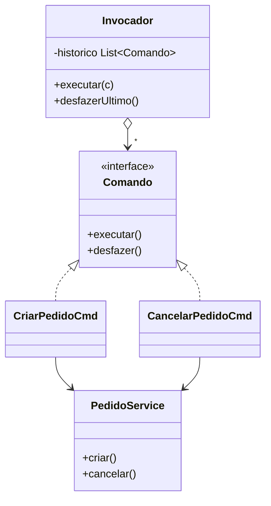

# Command

**Intenção:** encapsular uma solicitação como objeto.

**Problema:** desacoplar quem solicita uma operação de quem a executa, permitindo guardar e desfazer ações.

**Diagrama de classes**

**Participantes:** `Comando`, comandos concretos, `Invocador` (histórico) e `PedidoService` (Receptor).

**Exemplo adicional — Java:** [`Invocador`](../../src/main/java/br/edu/arquitetura/u2a3/comportamentais/command/Invocador.java) registra operações executadas e desfaz a última. [`CriarPedidoCmd`](../../src/main/java/br/edu/arquitetura/u2a3/comportamentais/command/CriarPedidoCmd.java) implementa a ação inversa removendo o pedido criado.

**Exemplo adicional — Spring:** comandos podem ser beans quando possuem dependências; histórico em memória é apenas demonstrativo, não uma fila durável.

**Consequências:** suporta fila, histórico, macros e desfazer/refazer; cada operação vira um objeto, e desfazer precisa de informação suficiente para restaurar o estado. `desfazer()` é uma extensão do exemplo, não uma exigência universal do padrão.

**SOLID:** SRP, pois separa a solicitação de sua execução; OCP facilita novos comandos.

**Smell:** lógica de operação acoplada a botões/rotas, ou difícil de armazenar e repetir como ação.

**Fonte:** Unidade 2 · Aula 3 — Prof. Nataniel Paiva.

**Diagrama editável:** [diagramas/command.mmd](../../diagramas/command.mmd).
