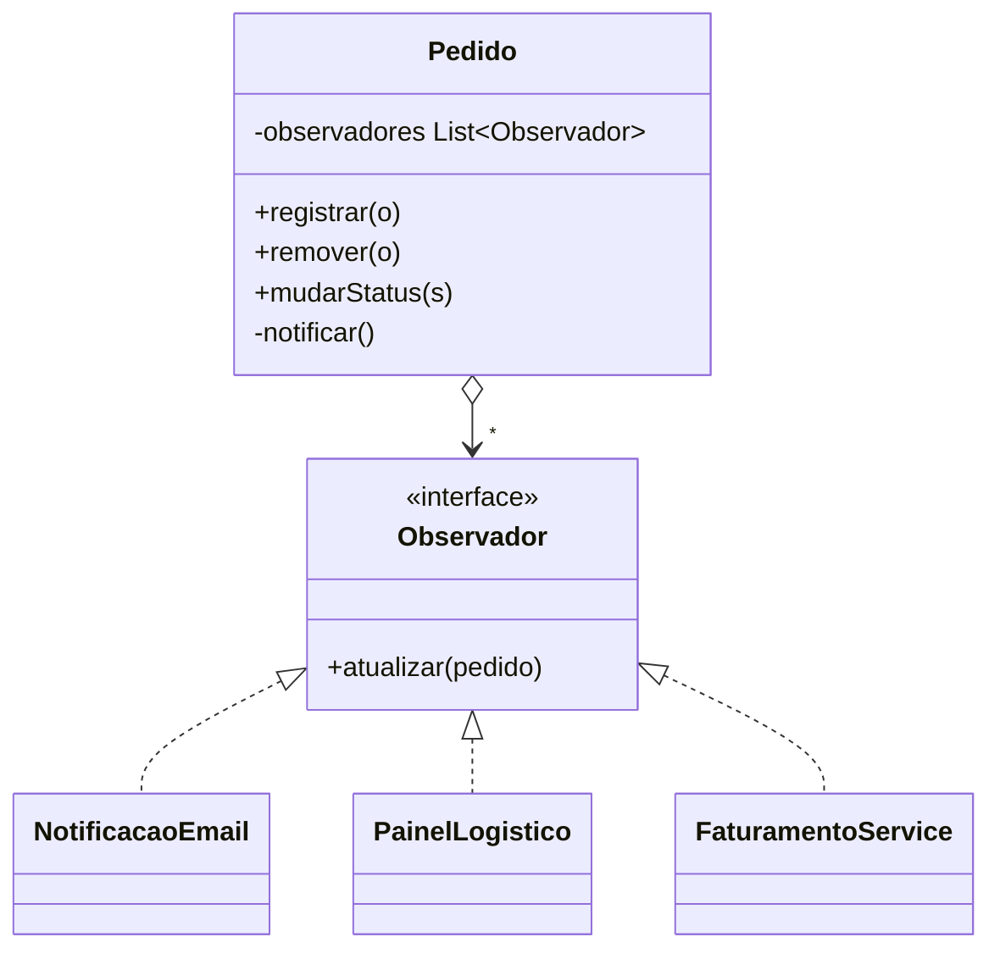

# Observer

**Intenção:** definir dependência um-para-muitos para notificar observadores quando o sujeito muda de estado.

**Problema:** vários consumidores precisam reagir à mudança de status de um pedido sem acoplá-los diretamente ao objeto Pedido.

**Diagrama de classes**

**Participantes:** `Pedido` (Sujeito), `Observador` e observadores concretos.

**Exemplo adicional — Java:** [`Pedido`](../../src/main/java/br/edu/arquitetura/u2a3/comportamentais/observer/Pedido.java) permite registrar/remover observadores e notifica uma cópia da lista ao mudar status.

**Exemplo adicional — Spring:** [`PublicadorPedido`](../../src/main/java/br/edu/arquitetura/u2a3/spring/observer/PublicadorPedido.java) usa `ApplicationEventPublisher`; consumidores podem reagir com `@EventListener`. Observer é uma base útil para arquitetura orientada a eventos, mas eventos Spring locais não são automaticamente assíncronos ou duráveis.

**Consequências:** desacopla sujeito e consumidores e permite vários observadores; ordem, falhas e ciclo de vida das inscrições devem ser considerados.

**SOLID:** OCP, pois novos observadores podem responder sem alterar o sujeito.

**Smell:** o sujeito conhece diretamente vários serviços que devem ser chamados após cada mudança de estado.

**Fonte:** Unidade 2 · Aula 3 — Prof. Nataniel Paiva.

**Diagramas editáveis:** [classes](../../diagramas/observer.mmd) · [sequência](../../diagramas/observer-sequencia.mmd).
