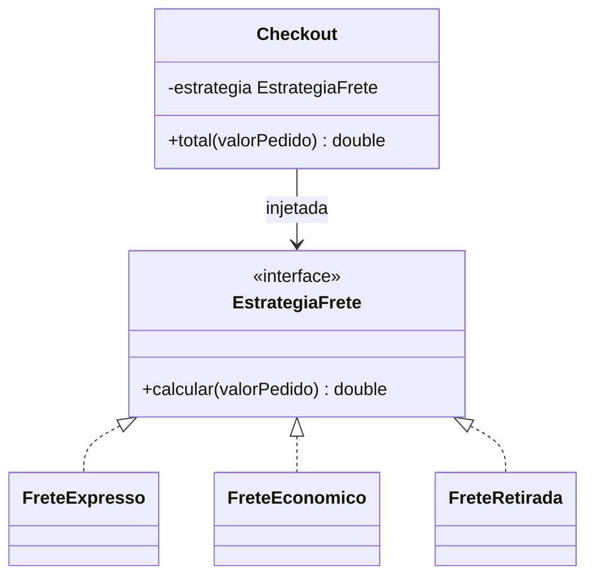

# Strategy

**Intenção:** definir uma família de algoritmos intercambiáveis e encapsular cada algoritmo.

**Problema:** cálculo de frete varia conforme a modalidade; condicionais por tipo crescem no checkout.

**Diagrama de classes**

**Participantes:** `EstrategiaFrete`, estratégias concretas e `Checkout` (Contexto).

**Exemplo adicional — Java:** [`Checkout`](../../src/main/java/br/edu/arquitetura/u2a3/comportamentais/strategy/Checkout.java) recebe a estratégia por construtor e não contém `if` por modalidade. Testes cobrem entrega expressa, econômica e retirada.

**Exemplo adicional — Spring:** injete `Map<String, EstrategiaFrete>` ou `List<EstrategiaFrete>` para selecionar uma implementação pelo identificador ou regra de domínio.

**Consequências:** troca algoritmos sem alterar o contexto e favorece composição; acrescenta objetos e a seleção da estratégia ainda precisa ter um dono claro.

**SOLID:** OCP — novas estratégias são adicionadas sem modificar o checkout.

**Smell:** cadeias de `if/switch` repetidas escolhem algoritmos por modalidade.

**Fonte:** Unidade 2 · Aula 3 — Prof. Nataniel Paiva.

**Diagrama editável:** [diagramas/strategy.mmd](../../diagramas/strategy.mmd).
