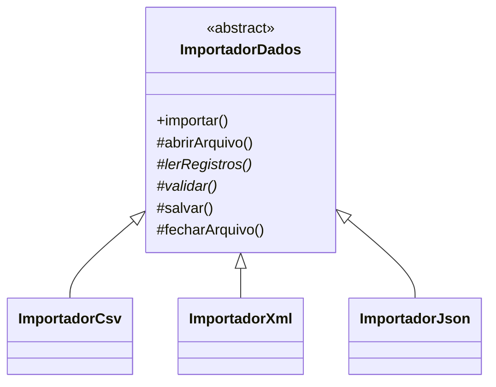

# Template Method

**Intenção:** definir o esqueleto de um algoritmo na classe-base e permitir que subclasses redefinam etapas.

**Problema:** importadores CSV/XML/JSON compartilham o fluxo abrir, ler, validar, salvar e fechar, mas variam a leitura e a validação.

**Diagrama de classes**

**Participantes:** `ImportadorDados` define o método-template e etapas comuns; subclasses concretas implementam passos variáveis.

**Exemplo adicional — Java:** [`ImportadorDados`](../../src/main/java/br/edu/arquitetura/u2a3/comportamentais/templatemethod/ImportadorDados.java) fixa o fluxo em `importar()` e fornece uma implementação CSV de demonstração.

**Exemplo adicional — Spring:** subclasses especializadas podem ser componentes `@Component` injetados por interface ou qualificador.

**Consequências:** evita duplicar o algoritmo estável; herança acopla a implementação ao esqueleto e mudanças no fluxo-base afetam todas as subclasses.

**SOLID:** OCP pode ser favorecido quando as etapas variáveis são extensões previstas; LSP exige que subclasses respeitem as expectativas do fluxo.

**Smell:** cópias quase idênticas do algoritmo diferem apenas em algumas etapas.

**Fonte:** Unidade 2 · Aula 3 — Prof. Nataniel Paiva.

**Diagrama editável:** [diagramas/template-method.mmd](../../diagramas/template-method.mmd).
