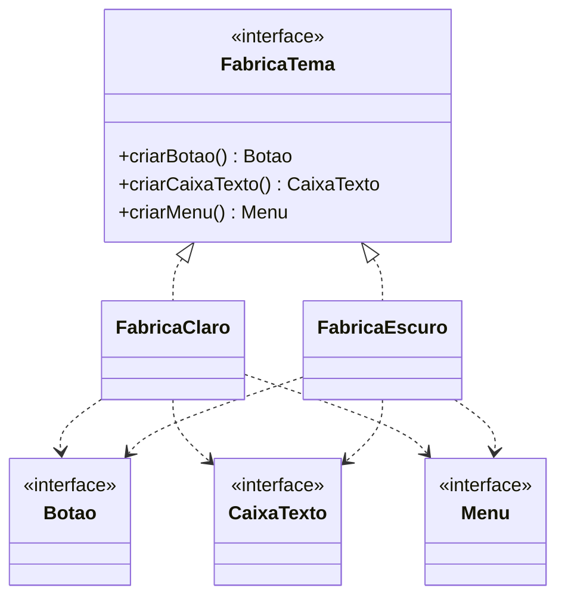

# Abstract Factory

**Intenção:** criar famílias de objetos relacionados sem especificar suas classes concretas.

**Problema:** componentes de uma mesma interface devem compartilhar um tema, sem misturar produtos claros e escuros.

**Diagrama de classes**

**Participantes:** `FabricaTema` (Fábrica Abstrata), fábricas concretas, interfaces de produto e produtos concretos.

**Exemplo adicional — Java:** [`FabricaTema`](../../src/main/java/br/edu/arquitetura/u2a3/criacionais/abstractfactory/FabricaTema.java) cria botão, caixa de texto e menu do mesmo tema. O teste verifica a consistência da família escura.

**Exemplo adicional — Spring:** uma configuração `@Configuration` pode expor os produtos como `@Bean`; perfil ou propriedade seleciona o conjunto de beans.

**Consequências:** mantém famílias coerentes e permite trocar uma família; adicionar um novo tipo de produto exige atualizar fábricas e famílias concretas.

**SOLID:** OCP para adicionar famílias; ISP deve orientar interfaces de produto coesas.

**Smell:** seleção espalhada de variantes que pode combinar componentes incompatíveis.

**Fonte:** Unidade 2 · Aula 3 — Prof. Nataniel Paiva.

**Diagrama editável:** [diagramas/abstract-factory.mmd](../../diagramas/abstract-factory.mmd).
