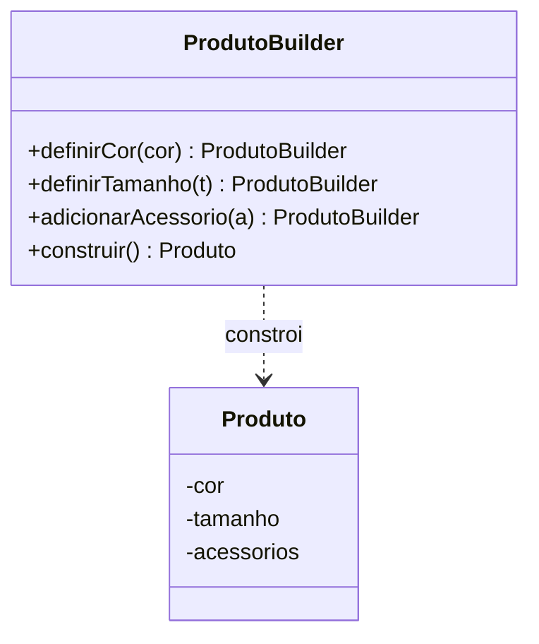

# Builder

**Intenção:** separar a construção de um objeto complexo de sua representação.

**Problema:** construtores com muitos parâmetros opcionais são difíceis de ler e propensos a erros.

**Diagrama de classes**



**Participantes:** `ProdutoBuilder` acumula as opções e constrói `Produto`.

**Exemplo adicional — Java:** [`Produto`](../../src/main/java/br/edu/arquitetura/u2a3/criacionais/builder/Produto.java) oferece métodos encadeáveis e valida tamanho positivo. A lista é copiada para manter o produto imutável.

```java
Produto produto = new Produto.Builder()
        .definirCor("azul")
        .definirTamanho(3)
        .adicionarAcessorio("estojo")
        .construir();
```

**Exemplo adicional — Spring:** `@Bean` pode construir objetos com dependências; para fins didáticos, o Builder manual evita esconder o padrão em Lombok.

**Consequências:** torna a configuração legível e permite validar no momento da construção; adiciona uma classe e pode ser excessivo para objetos simples.

**SOLID:** SRP, pois separa o processo de construção da representação.

**Smell:** muitos construtores sobrecarregados ou booleanos/parâmetros opcionais cuja ordem não é evidente.

**Fonte:** Unidade 2 · Aula 3 — Prof. Nataniel Paiva.

**Diagrama editável:** [diagramas/builder.mmd](../../diagramas/builder.mmd).
