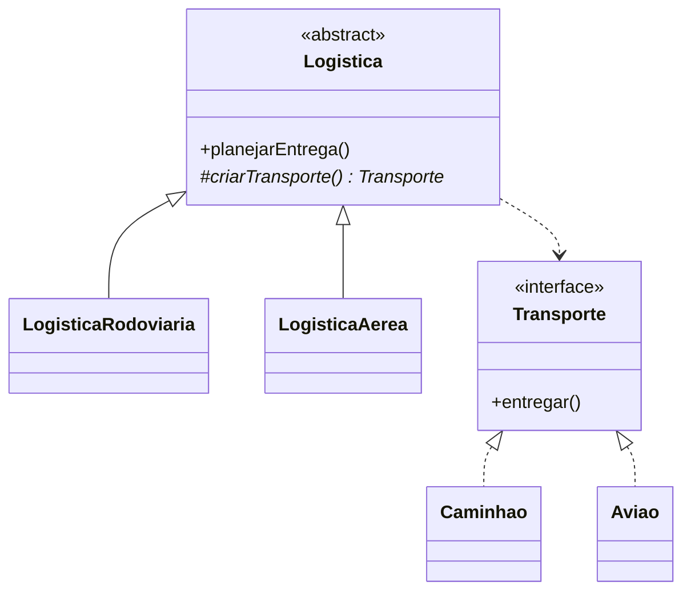

# Factory Method

**Intenção:** definir uma interface para criar um produto, deixando subclasses decidirem a classe concreta.

**Problema:** o criador precisa planejar uma entrega, mas não deve conhecer diretamente todos os tipos de transporte.

**Diagrama de classes**

**Participantes:** `Logistica` (Criador), `LogisticaRodoviaria`/`LogisticaAerea` (Criadores concretos), `Transporte` (Produto) e seus produtos concretos.

**Exemplo adicional — Java:** [`Logistica`](../../src/main/java/br/edu/arquitetura/u2a3/criacionais/factorymethod/Logistica.java) implementa a logística rodoviária e aérea. As subclasses sobrescrevem `criarTransporte()`; o teste verifica o resultado de cada entrega.

**Exemplo adicional — Spring:** métodos `@Bean` em `@Configuration` podem atuar como pontos de criação; `@Profile` ou `@ConditionalOnProperty` seleciona a implementação.

**Consequências:** delega criação e reduz acoplamento do cliente a produtos concretos; cada nova variação pode exigir nova subclasse.

**SOLID:** OCP, pois novos criadores podem ser adicionados sem alterar o fluxo do criador-base.

**Smell:** `switch` repetido por tipo de transporte em vários clientes.

**Fonte:** Unidade 2 · Aula 3 — Prof. Nataniel Paiva.

**Diagrama editável:** [diagramas/factory-method.mmd](../../diagramas/factory-method.mmd).
