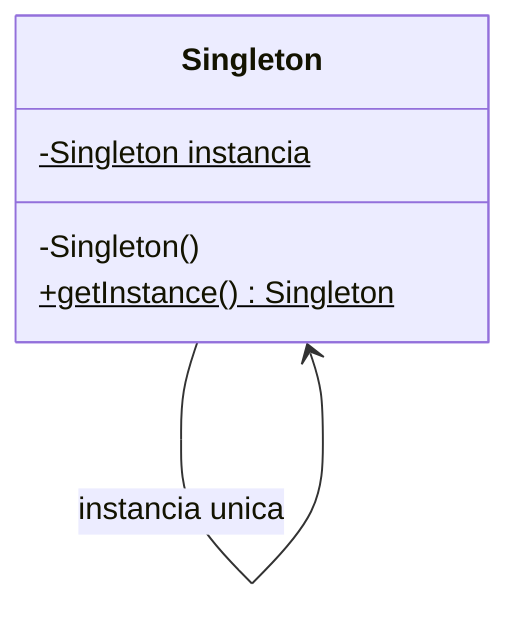

# Singleton

**Intenção:** garantir uma única instância de uma classe e oferecer um ponto de acesso a ela.

**Problema:** várias partes da aplicação precisam compartilhar uma configuração ou serviço, mas instâncias independentes podem divergir.

**Diagrama de classes**



**Participantes:** `Singleton` mantém a instância privada, controla sua criação e expõe `getInstance()`.

**Exemplo adicional — Java:** [`ConfiguracaoLog`](../../src/main/java/br/edu/arquitetura/u2a3/criacionais/singleton/ConfiguracaoLog.java) usa inicialização *holder*, thread-safe e sob demanda. O teste comprova que as chamadas retornam a mesma instância.

**Exemplo adicional — Spring:** prefira injetar um bean; o escopo padrão já é singleton:

```java
@Component
class ConfiguracaoLogSpring {
    String nivel() { return "INFO"; }
}
```

**Consequências/crítica:** simplifica o acesso, porém introduz estado global implícito, mascara acoplamento e dificulta testes. Prefira injeção de dependência, coerente com DIP, salvo quando a unicidade fizer parte real do domínio.

**SOLID:** DIP é favorecido pela alternativa de injeção; o Singleton global pode violar DIP e SRP.

**Smell:** chamadas globais a `getInstance()` espalhadas ou testes que dependem de estado compartilhado.

**Fonte:** Unidade 2 · Aula 3 — Prof. Nataniel Paiva.

**Diagrama editável:** [diagramas/singleton.mmd](../../diagramas/singleton.mmd).
