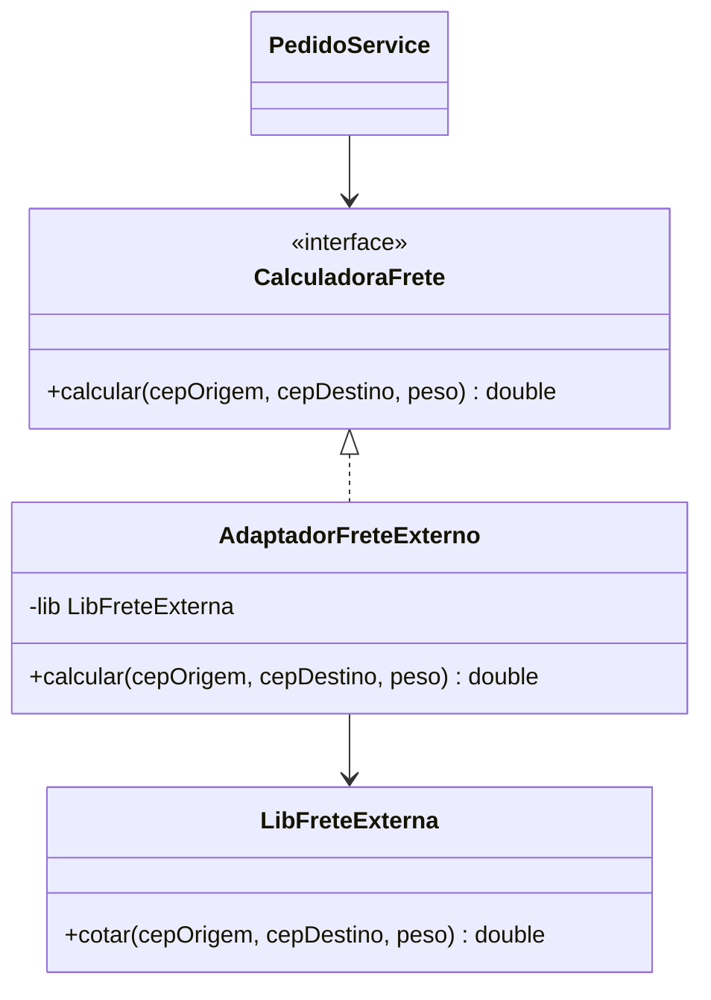

# Adapter

**Intenção:** converter uma interface em outra que o cliente espera.

**Problema:** uma biblioteca externa de frete expõe `cotar(...)`, enquanto a aplicação depende de `calcular(...)`.

**Diagrama de classes**

**Participantes:** `CalculadoraFrete` (interface-alvo), `AdaptadorFreteExterno` e `LibFreteExterna` (adaptado).

**Exemplo adicional — Java:** [`AdaptadorFreteExterno`](../../src/main/java/br/edu/arquitetura/u2a3/estruturais/adapter/AdaptadorFreteExterno.java) implementa o contrato da aplicação e delega à biblioteca.

**Exemplo adicional — Spring:** registre o adaptador como `@Component` e injete `CalculadoraFrete` no serviço consumidor.

**Consequências:** reutiliza uma implementação incompatível sem alterar o cliente ou a biblioteca; uma tradução complexa pode tornar o adaptador difícil de manter.

**SOLID:** DIP, pois o cliente depende da abstração da aplicação, não da biblioteca concreta.

**Smell:** código cliente repetidamente traduz parâmetros ou conhece tipos específicos da biblioteca.

**Fonte:** Unidade 2 · Aula 3 — Prof. Nataniel Paiva.

**Diagrama editável:** [diagramas/adapter.mmd](../../diagramas/adapter.mmd).
