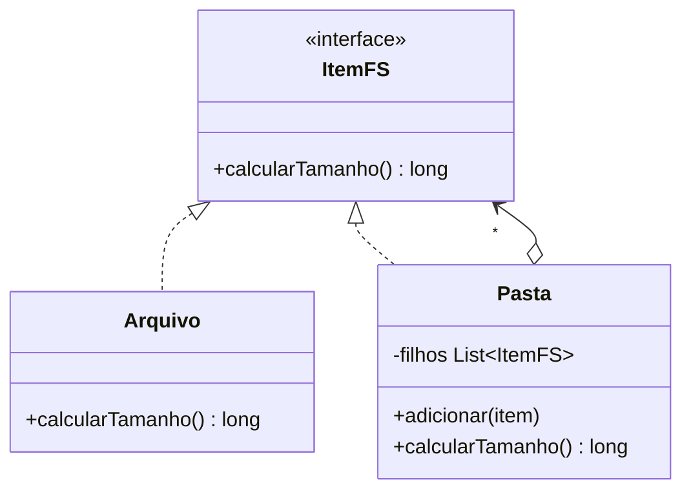

# Composite

**Intenção:** compor objetos em estruturas de árvore e tratar objetos individuais e composições uniformemente.

**Problema:** calcular o tamanho de um arquivo ou de uma pasta sem criar caminhos de execução diferentes para cada nível da árvore.

**Diagrama de classes**

**Participantes:** `ItemFS` (Componente), `Arquivo` (Folha) e `Pasta` (Composto).

**Exemplo adicional — Java:** [`Pasta`](../../src/main/java/br/edu/arquitetura/u2a3/estruturais/composite/Pasta.java) soma recursivamente os tamanhos de seus itens; folhas e compostos implementam `ItemFS`.

**Consequências:** simplifica clientes que percorrem árvores; pode ser difícil impor restrições específicas às folhas e compostos por uma interface uniforme.

**SOLID:** OCP, ao permitir novas folhas ou compostos sem mudar o cliente que usa `ItemFS`.

**Smell:** verificações repetidas do tipo do item para percorrer hierarquias parte-todo.

**Fonte:** Unidade 2 · Aula 3 — Prof. Nataniel Paiva.

**Diagrama editável:** [diagramas/composite.mmd](../../diagramas/composite.mmd).
