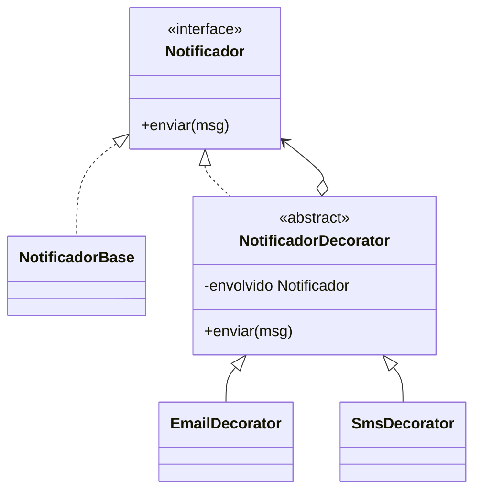

# Decorator

**Intenção:** adicionar responsabilidades dinamicamente, envolvendo um objeto que implementa a mesma interface.

**Problema:** combinar canais de notificação sem criar uma subclasse para cada combinação de e-mail e SMS.

**Diagrama de classes**

**Participantes:** `Notificador` (Componente), `NotificadorBase` (Componente Concreto), `NotificadorDecorator` (Decorador abstrato) e decoradores concretos.

**Exemplo adicional — Java:** [`EmailDecorator`](../../src/main/java/br/edu/arquitetura/u2a3/estruturais/decorator/EmailDecorator.java) e `SmsDecorator` compõem canais em volta de `NotificadorBase`; o teste compõe ambos.

**Exemplo adicional — Spring:** beans decoradores podem ser compostos explicitamente ou selecionados com `@Primary`, evitando ciclos de injeção.

**Consequências:** combina responsabilidades em tempo de execução e evita explosão de subclasses; a cadeia de objetos pode dificultar depuração e ordenação dos efeitos.

**SOLID:** OCP, ao acrescentar responsabilidades por composição sem modificar o componente.

**Smell:** subclasses como `NotificadorEmailSmsPush` que representam combinações de funcionalidades independentes.

**Fonte:** Unidade 2 · Aula 3 — Prof. Nataniel Paiva.

**Diagrama editável:** [diagramas/decorator.mmd](../../diagramas/decorator.mmd).
