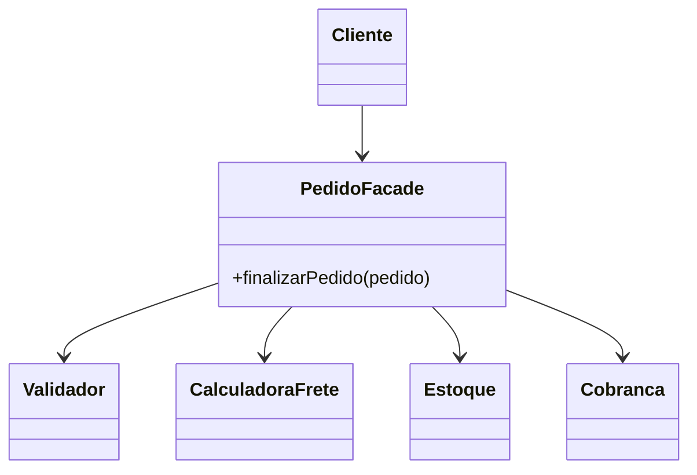

# Facade

**Intenção:** oferecer uma interface unificada e simplificada para um subsistema.

**Problema:** finalizar um pedido exige coordenar validação, cálculo de frete, reserva de estoque e cobrança.

**Diagrama de classes**

**Participantes:** `Cliente`, `PedidoFacade` e as classes do subsistema.

**Exemplo adicional — Java:** [`PedidoFacade`](../../src/main/java/br/edu/arquitetura/u2a3/estruturais/facade/PedidoFacade.java) coordena as quatro operações e recebe suas dependências por construtor.

**Exemplo adicional — Spring:** uma facade pode ser um `@Service`; a anotação não substitui a decisão de manter acesso às classes internas quando necessário.

**Consequências:** reduz o conhecimento exigido do cliente e centraliza um fluxo de caso de uso; não deve virar um serviço monolítico nem **esconder** as classes internas.

**SOLID:** ISP, ao oferecer ao cliente uma interface de alto nível coesa; SRP orienta manter responsabilidades distintas no subsistema.

**Smell:** clientes replicam a mesma sequência de chamadas a vários serviços para concluir um único caso de uso.

**Fonte:** Unidade 2 · Aula 3 — Prof. Nataniel Paiva.

**Diagrama editável:** [diagramas/facade.mmd](../../diagramas/facade.mmd).
