# Unidade 2 · Aula 3 — Padrões GoF: Criacionais, Estruturais e Comportamentais

> **Curso:** Arquitetura de Sistemas e Microsserviços · **Unidade 2 · Aula 3** · Prof. Nataniel Paiva
> **Fonte:** `Aula3_..._Padrões GoF Criacionais, Estruturais e Comportamentais_unidade02_aula03.pptx` (43 slides)

Este README é um **briefing para outra IA** criar um **catálogo visual dos 12 padrões GoF** da aula. Conteúdo extraído dos slides; os diagramas de classes em Mermaid são **exemplos prontos** para o GitHub.

---

## 1. Objetivo do projeto a ser gerado

Um catálogo em que **cada padrão tenha**: intenção, quando usar, diagrama de classes Mermaid, exemplo de código curto e consequências/críticas. Organizado nas três categorias.

**Idioma:** PT-BR.

### 1.1 Stack de código (obrigatória)

> **Todo código do projeto DEVE ser em Java com Spring.** Não gerar exemplos em outras linguagens.

- **Java 21 (LTS)** + **Spring Boot 3.x** · **Maven** · **JUnit 5** + Mockito.
- Pacote base sugerido: `br.edu.arquitetura.u2a3` com um subpacote por padrão (`criacionais.singleton`, `estruturais.adapter`, `comportamentais.strategy`...), cada um com **classes + teste**.
- Implementar os padrões em **Java puro nas classes do domínio** (para o padrão ficar visível) e **mostrar a versão "à la Spring"** quando houver equivalente — marcar como *exemplo adicional*:
| Padrão | Versão Spring |
|---|---|
| **Singleton** | escopo `singleton` (padrão) do bean + **injeção de dependência**, como os slides recomendam no lugar do `getInstance()` |
| **Factory Method / Abstract Factory** | métodos `@Bean` em `@Configuration`; seleção por perfil/propriedade (`@ConditionalOnProperty`) |
| **Builder** | Builder manual em Java (sem Lombok nos exemplos didáticos) |
| **Adapter** | `@Component` implementando a interface da aplicação sobre a biblioteca externa |
| **Decorator** | beans decoradores (`@Primary`/composição explícita) para os canais de notificação |
| **Facade** | `@Service` (ex.: `PedidoFacade.finalizarPedido()`) |
| **Composite** | classes de domínio em Java puro (árvore pasta/arquivo) |
| **Strategy** | `Map<String, EstrategiaFrete>` / `List<EstrategiaFrete>` injetados |
| **Observer** | `ApplicationEventPublisher` + `@EventListener` (status do pedido) |
| **Template Method** | classe abstrata + subclasses `@Component` (importadores CSV/XML/JSON) |
| **Command** | interface `Comando` com `executar()`/`desfazer()` e histórico em memória |

## 2. Resumo do conteúdo (fonte de verdade)

### 2.1 Criacionais
| Padrão | Intenção | Estrutura / exemplo dos slides |
|---|---|---|
| **Singleton** | uma única instância + ponto de acesso global | construtor privado + `getInstance()` estático (cria na 1ª chamada). **Crítica:** estado global implícito, dificulta testes, mascara acoplamento → preferir **injeção de dependência** (coerente com DIP). Ex.: config de logging, gerenciador de conexões |
| **Factory Method** | interface para criar objeto; **subclasses decidem** a classe concreta | Criador abstrato (`criarTransporte()`), Criadores concretos, hierarquia de Produtos. Ex.: tipos de transporte de entrega |
| **Abstract Factory** | criar **famílias** de objetos relacionados sem especificar classes concretas | Ex.: botão, caixa de texto e menu de um **tema**; trocar a fábrica troca a família inteira |
| **Builder** | separa construção do objeto complexo de sua representação | métodos encadeáveis (`definirCor()`, `definirTamanho()`, `adicionarAcessorio()`) + `construir()`; evita construtor com lista longa de parâmetros |

### 2.2 Estruturais
| Padrão | Intenção | Estrutura / exemplo |
|---|---|---|
| **Adapter** | converte uma interface em outra esperada pelo cliente | classe adaptadora implementa a interface esperada e traduz chamadas à biblioteca real. Ex.: biblioteca externa de **cálculo de frete** |
| **Decorator** | adiciona responsabilidades dinamicamente sem explosão de subclasses | Componente abstrato + concreto + Decoradores que implementam a mesma interface e envolvem outro Componente. Ex.: notificação por **e-mail** e **SMS** combináveis |
| **Facade** | interface unificada e simplificada para um subsistema | ex.: `finalizarPedido()` coordena validação, frete, estoque e cobrança; **não esconde** as classes internas |
| **Composite** | árvore parte-todo; trata individual e composição de modo uniforme | interface comum (`calcularTamanho()`) em folhas e compostos. Ex.: pastas/arquivos; categorias/produtos |

### 2.3 Comportamentais
| Padrão | Intenção | Estrutura / exemplo |
|---|---|---|
| **Strategy** | família de algoritmos intercambiáveis | substitui condicionais por tipo (ex.: **cálculo de frete**); estratégia **injetada**; aplicação do **OCP** |
| **Observer** | dependência um-para-muitos; Sujeito notifica Observadores | lista de observadores + registrar/remover + notificar. Base de eventos, GUIs e arquiteturas orientadas a eventos. Ex.: **mudança de status de pedido** |
| **Template Method** | esqueleto do algoritmo na classe base; subclasses redefinem passos | ex.: importação — abrir, ler, validar, salvar, fechar; varia leitura e validação (CSV/XML/JSON) |
| **Command** | encapsula uma solicitação como objeto | interface com `executar()`; base de filas assíncronas, **desfazer/refazer** e macros |

---

## 3. Diagramas Mermaid (renderizam no GitHub)

### 3.1 Criacionais

**Singleton**
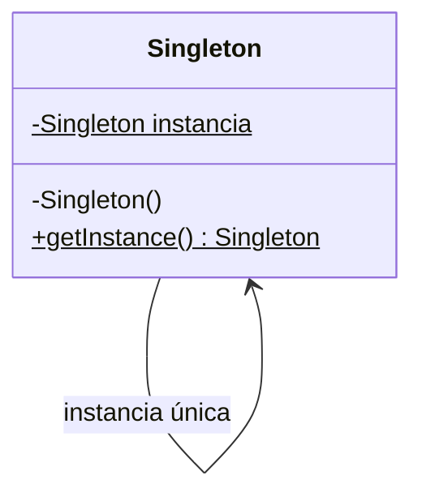

**Factory Method — transportes de entrega**
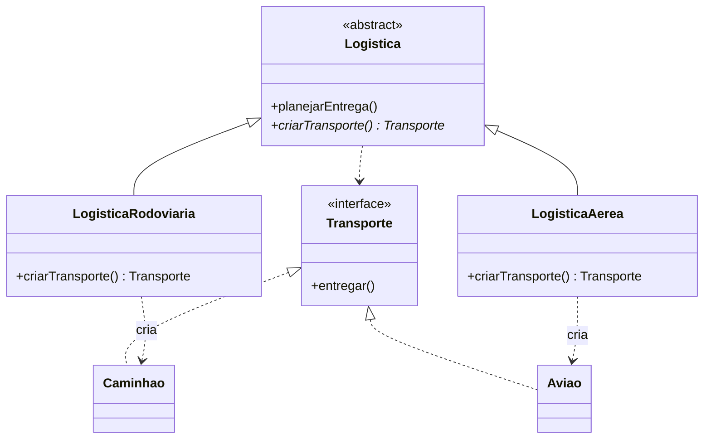

**Abstract Factory — temas de interface**
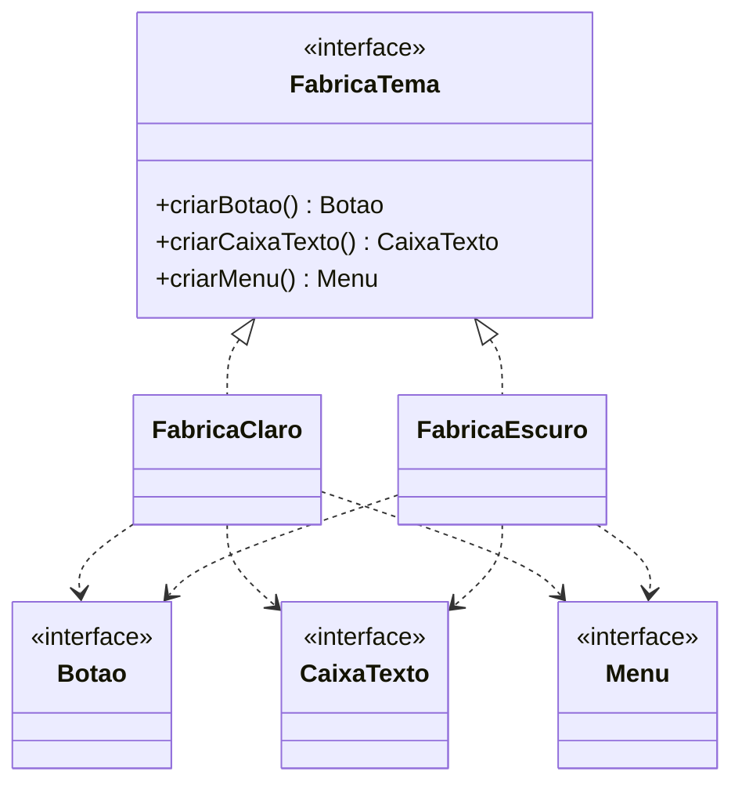

**Builder**
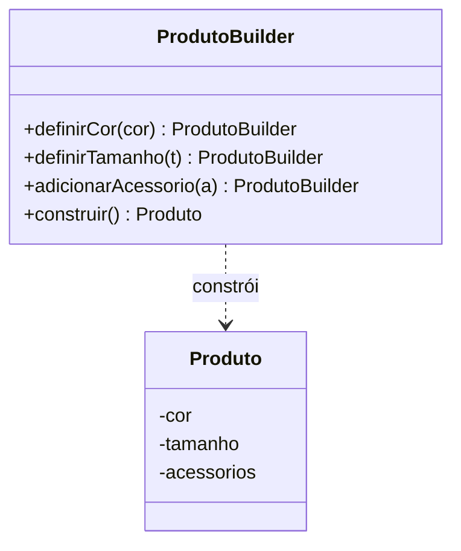

### 3.2 Estruturais

**Adapter — biblioteca externa de frete**
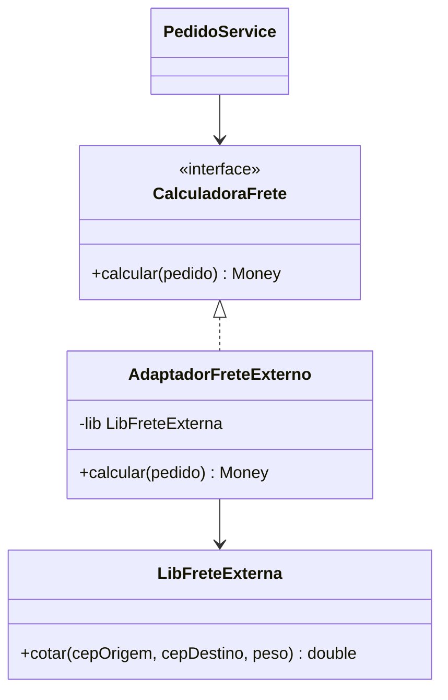

**Decorator — canais de notificação**
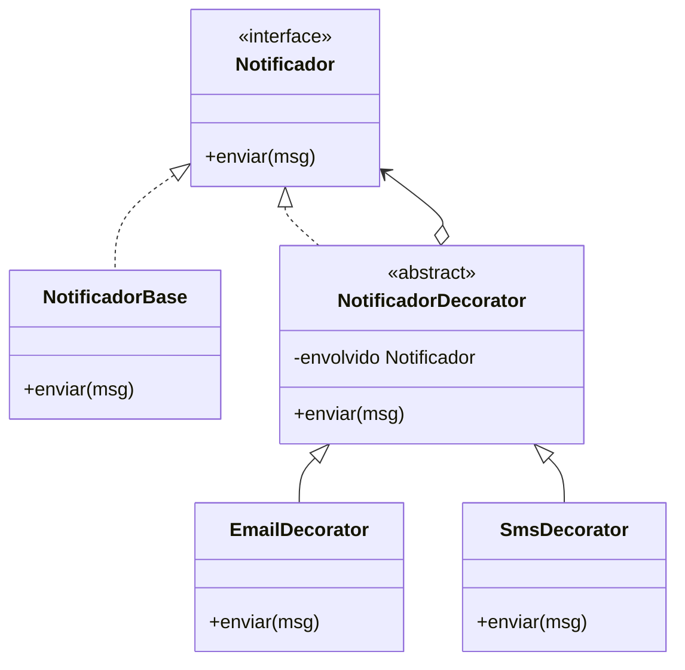

**Facade — finalizar pedido**
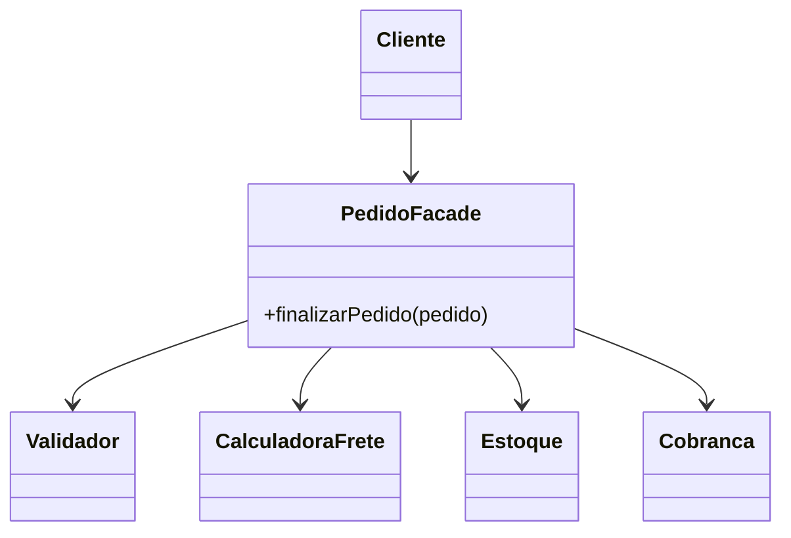

**Composite — sistema de arquivos**
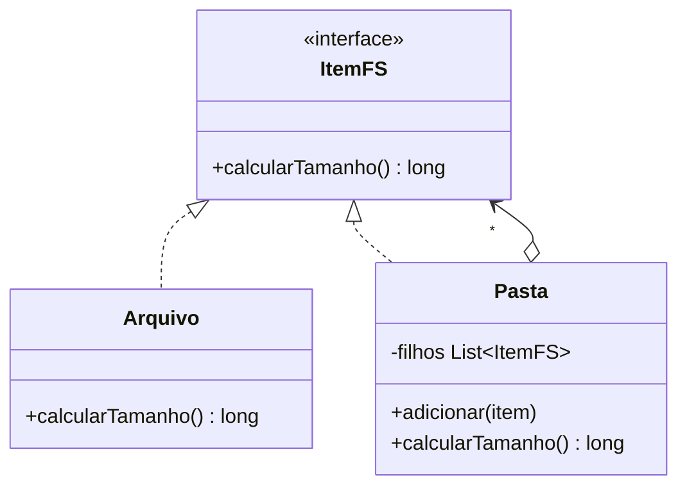

### 3.3 Comportamentais

**Strategy — frete**
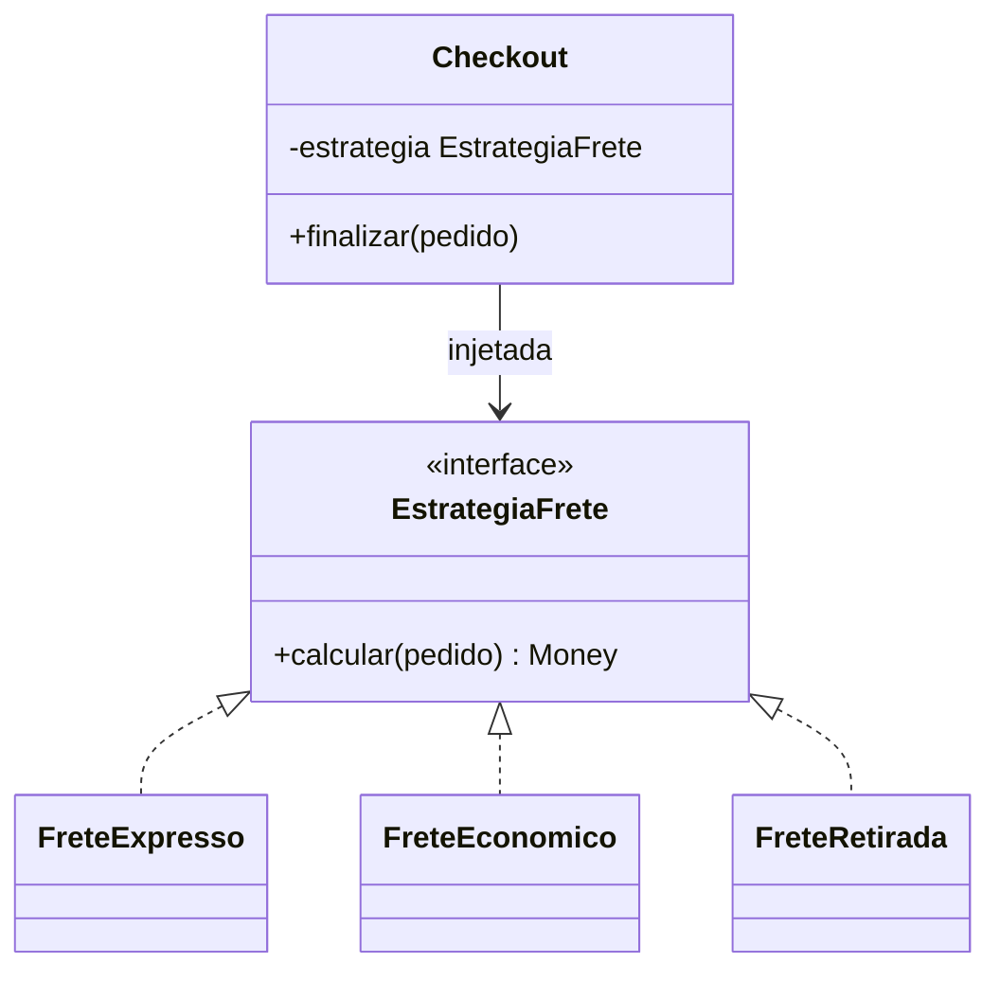

**Observer — status do pedido**
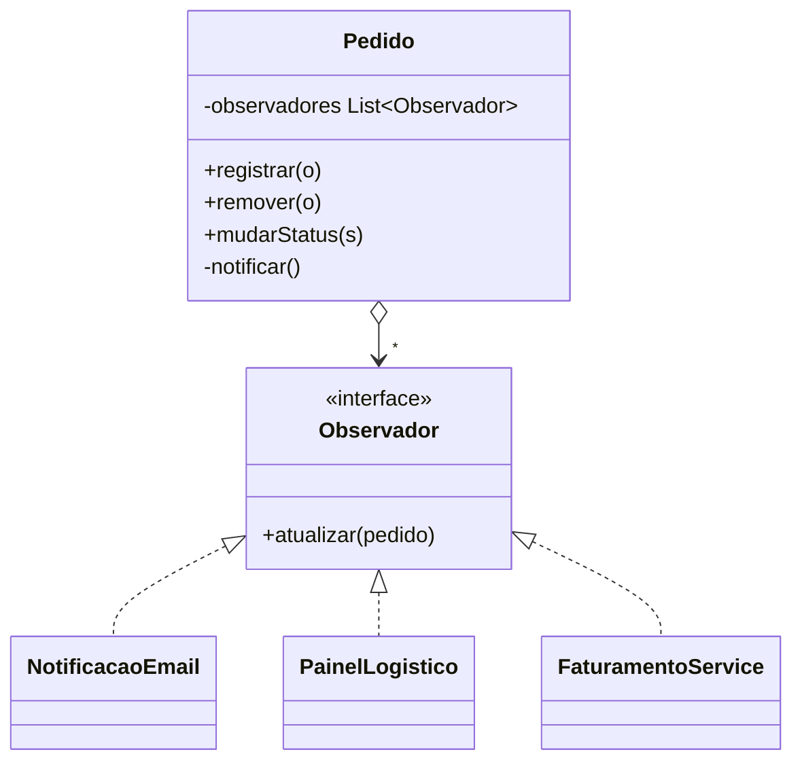

**Template Method — importação de dados**
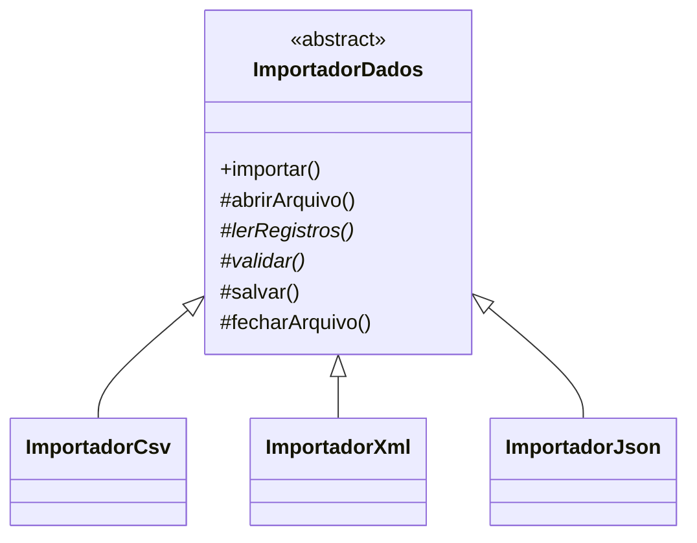

**Command — desfazer/refazer**
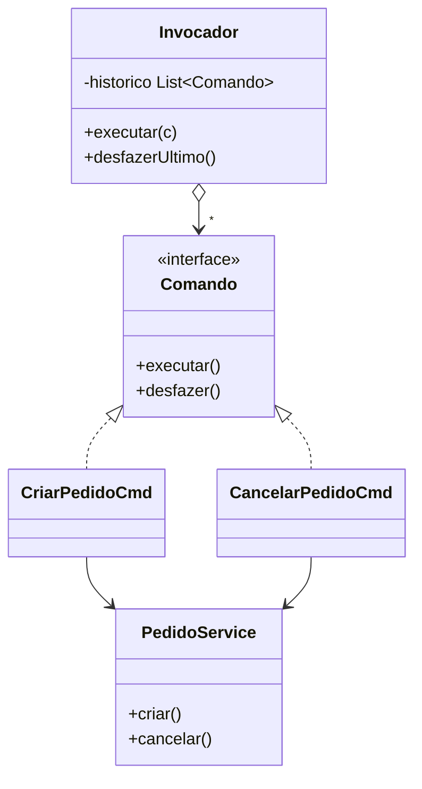

> `desfazer()` aparece porque o slide cita suporte a desfazer/refazer; só `executar()` é citado como obrigatório.

### 3.4 Observer em sequência (*exemplo adicional*)

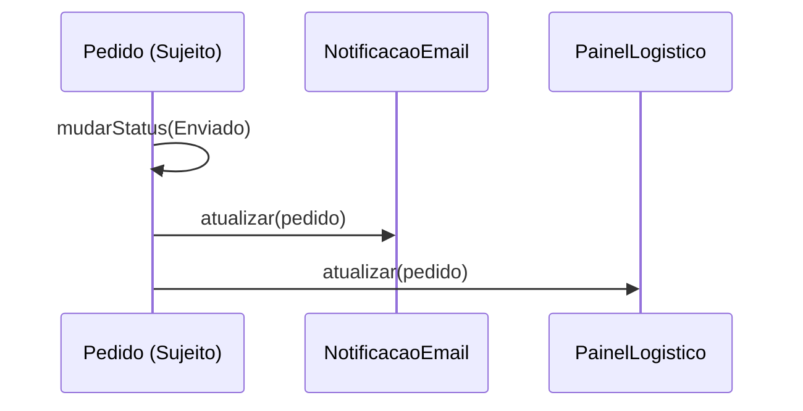

### 3.5 Qual padrão escolher (resumo)

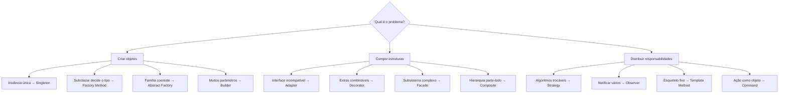

---

## 4. Estrutura sugerida do projeto a gerar

```
unidade2-aula3-projeto/
├── README.md                      # catálogo + diagrama "qual padrão escolher"
├── catalogo/
│   ├── criacionais/  singleton.md  factory-method.md  abstract-factory.md  builder.md
│   ├── estruturais/  adapter.md  decorator.md  facade.md  composite.md
│   └── comportamentais/  strategy.md  observer.md  template-method.md  command.md
├── diagramas/                     # .mmd fonte
├── exemplos/                      # código executável + testes por padrão
└── comparativos.md                # Factory Method × Abstract Factory; Adapter × Facade; Strategy × Template Method
```

**Ficha por padrão:** intenção · problema · diagrama de classes · participantes · exemplo de código · consequências · princípio SOLID relacionado · smell que o sinaliza.

## 5. Regras para a IA que for gerar o projeto

1. **Os 12 padrões**, todos com `classDiagram` Mermaid e os nomes dos participantes dos slides (Criador/Produto, Componente/Decorador, Sujeito/Observador).
2. **Crítica ao Singleton** obrigatória, com a alternativa de injeção de dependência.
3. Facade **não esconde** as classes internas; Observer é base de arquiteturas orientadas a eventos — destacar.
4. Exemplos de código curtos, **com testes** (ex.: Strategy sem `if`, Command com desfazer).
5. **Mermaid:** nomes sem espaços, genéricos com `~T~`, estático com `$`, abstrato com `*`; testar renderização.
6. Marcar como *"exemplo adicional"* o que extrapola os slides (nomes de classes específicos, código).
7. Citar: *Unidade 2 · Aula 3 — Prof. Nataniel Paiva*.

## 6. Checklist de aceitação

- [ ] 12 fichas de padrão com diagrama de classes renderizando
- [ ] Alternativa DI ao Singleton explicada
- [ ] Comparativos entre padrões parecidos
- [ ] Diagrama "qual padrão escolher"
- [ ] Conexão com SOLID (Strategy→OCP, Adapter→DIP, Facade→ISP)
